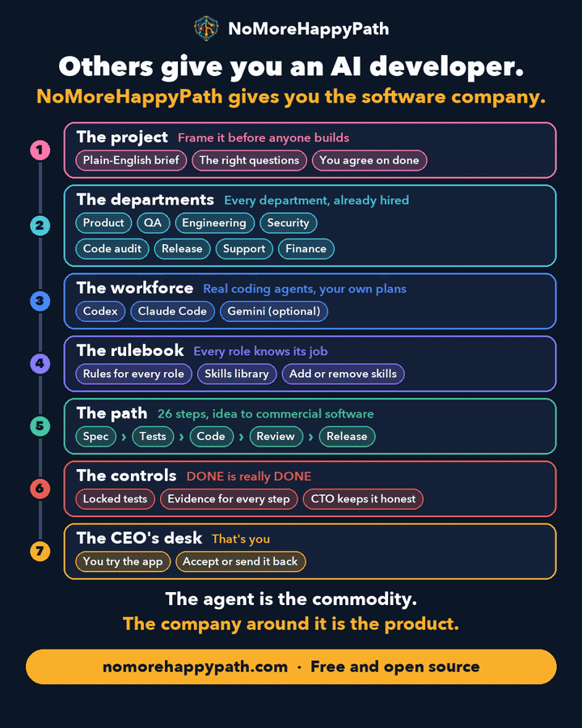

# NoMoreHappyPath

**Others give you an AI developer. NoMoreHappyPath gives you the software company.**

NoMoreHappyPath is a free and open-source system for building commercial software with AI agents. It gives you every department a software company has, already hired: product, QA, engineering, security, code audit, CTO, release, support and finance. The work is checked by an AI from a different company than the one that built it, through 26 steps from idea to commercial software. You are the CEO: nothing is done until you accept it. It runs real coding agents on the AI subscriptions you already have: Codex, Claude Code and, optionally, Gemini.

- **Start here:** [nomorehappypath/nomorehappypath](https://github.com/nomorehappypath/nomorehappypath)
- **Website:** [nomorehappypath.com](https://nomorehappypath.com)
